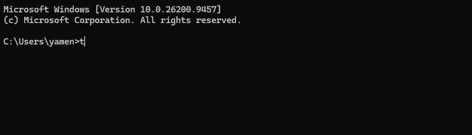

<div align='center'>


# Terminote
A Task management module controlled using CLI commands
<div align='left'>

## Features
* Note taking and removing
* Basic CLI UI for navigation
* multiple notebook (profiles)

## Planned Features (coming soon)
* priority indicator
* due dates
* recurring tasks


## Installation
Terminote can be installed as either an installer file (in the 'releases' tab of this repo) or by cloning/downloading the repository

### Downloaded Repo
1) Extract the downloaded .zip file into a folder you like
2) open the directory of the program
3) run ```python main.py``` to test it
4) turn it into an .exe file using pyinstaller
    * ```pyinstaller --onefile main.py```
5) rename it to "terminote.exe" (yes this is important :P )
6) you now have a usable .exe app of terminote, in order to use it from any terminal you'll have to add it to your system's PATH (more on that below) 

#### Adding to PATH
1) Locate your "terminote.exe" file and copy it's path (right-click)
2) Look for "environment variables" in the start menu


3) click on the user variable called 'Path' and select 'edit'
4) press "New" and simply paste the "terminote.exe" path you copied
5) open any terminal/cmd and type "terminote"

### Installer
1) Download the installer from the "releases" tab
2) run it and go through the installation
3) open any teminal and type "terminote"




Congrats!